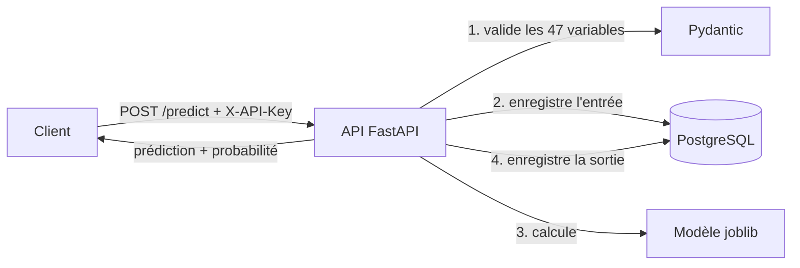

# API de prédiction d'attrition — Futurisys (Projet 5)

POC qui déploie le modèle de Machine Learning du projet 4 (Random Forest, prédiction du départ d'un employé de TechNova Partners) via une API FastAPI. Chaque requête et chaque prédiction sont enregistrées dans une base PostgreSQL.

Projet réalisé par Antoine CHEMAVONIAN dans le cadre du projet 5 (Déployez un modèle de Machine Learning).

## Sommaire
1. [Architecture](#architecture)
2. [Prérequis](#prérequis)
3. [Installation](#installation)
4. [Configuration](#configuration)
5. [Lancement](#lancement)
6. [Utilisation de l'API](#utilisation-de-lapi)
7. [Base de données et gestion des données](#base-de-données-et-gestion-des-données)
8. [Authentification et sécurité](#authentification-et-sécurité)
9. [Tests](#tests)
10. [CI/CD et environnements](#cicd-et-environnements)
11. [Déploiement](#déploiement)
12. [Besoins analytiques](#besoins-analytiques)
13. [Structure du dépôt](#structure-du-dépôt)
14. [Conventions Git](#conventions-git)
15. [Choix techniques](#choix-techniques)
16. [Maintenance](#maintenance)

## Architecture



## Prérequis
- Python 3.11
- Docker et Docker Compose (pour le lancement avec PostgreSQL)
- Git

## Installation

```bash
git clone https://github.com/antoinechemavonian/futurisys-api-projet-5.git
cd futurisys-api-projet-5
python -m venv .venv
source .venv/bin/activate        # Windows : .venv\Scripts\activate
pip install -r requirements-dev.txt
```

## Configuration
Les réglages passent par des variables d'environnement. Copier le modèle puis le remplir :

```bash
cp .env.example .env
```

| Variable | Rôle |
|---|---|
| `DATABASE_URL` | Connexion à la base. Par défaut : SQLite local `predictions.db` |
| `API_KEY` | Clé exigée dans l'en-tête `X-API-Key`. Vide : pas d'authentification (développement) |
| `POSTGRES_USER`, `POSTGRES_PASSWORD`, `POSTGRES_DB` | Identifiants de la base utilisée par Docker Compose |
| `MODEL_VERSION` | Version du modèle enregistrée avec chaque prédiction (défaut `1.0.0`) |

Le fichier `.env` est ignoré par Git : aucun secret n'est versionné.

## Lancement

**Avec Docker (API + PostgreSQL) :**
```bash
docker compose up --build
```
L'API écoute sur `http://localhost:8000`, la documentation Swagger sur `http://localhost:8000/docs`.

**Sans Docker (SQLite) :**
```bash
uvicorn app.main:app --reload
```

## Utilisation de l'API

| Route | Rôle | Authentification |
|---|---|---|
| `GET /health` | Vérifie que l'API et le modèle sont prêts | Non |
| `POST /predict` | Retourne la prédiction et la probabilité, et les enregistre | Oui |
| `GET /predictions?limite=20` | Dernières prédictions enregistrées | Oui |
| `GET /docs` | Documentation Swagger (schémas et exemples d'appels) | Non |

L'API attend les **47 variables** du modèle, toutes obligatoires (voir l'exemple dans Swagger ou `data/exemples_predictions.csv`). Une requête incomplète ou invalide reçoit une erreur `422` avec le détail.

```bash
curl -X POST http://localhost:8000/predict \
  -H "X-API-Key: $API_KEY" -H "Content-Type: application/json" \
  @data/exemple_employe.json
```

Réponse :
```json
{"id": 1, "prediction": "Non", "probabilite": 0.18, "seuil": 0.333, "version_modele": "1.0.0"}
```

## Base de données et gestion des données

Schéma détaillé et diagramme : [docs/schema_bdd.md](docs/schema_bdd.md).

**Trois tables :**
- `employes` : le dataset (1470 employés, 47 variables + résultat réel)
- `prediction_inputs` : chaque requête reçue
- `prediction_outputs` : chaque prédiction, liée à son entrée (relation 1-1)

**Processus de stockage :**
1. Le dataset est chargé une fois avec `python -m scripts.load_dataset`.
2. À chaque appel de `/predict`, l'entrée puis la sortie sont écrites dans **une seule transaction** : si le modèle échoue, rien n'est enregistré.
3. Les contraintes de la base (`CHECK`, clés étrangères, unicité) garantissent la cohérence des données.

**Mise en place :**
```bash
python -m scripts.create_db                                      # crée les tables
python -m scripts.load_dataset data/dataset_employes.csv --cible a_quitte_l_entreprise
python -m scripts.query_db                                       # statistiques et dernières prédictions
```
`data/exemples_predictions.csv` contient des exemples d'entrées et de sorties réelles du modèle.

## Authentification et sécurité
- **Clé d'API** : les routes `/predict` et `/predictions` exigent l'en-tête `X-API-Key`. La clé vient de la variable `API_KEY` et est comparée en temps constant. Sans clé valide : erreur `401`.
- **Pas de comptes utilisateurs** : l'API ne stocke aucun mot de passe, donc rien à hacher. La clé n'est jamais écrite dans le code ni dans les journaux.
- **Secrets** : `.env` est ignoré par Git. En CI/CD, les secrets (`API_KEY`) sont stockés dans les *GitHub Secrets* de l'environnement `production`.
- **Validation stricte** : Pydantic refuse les champs manquants, inconnus ou hors bornes (erreur `422`).
- **Base** : requêtes via l'ORM SQLAlchemy (paramétrées, pas de SQL concaténé). En production, utiliser un utilisateur PostgreSQL dédié à l'API avec les seuls droits nécessaires.

## Tests

```bash
pytest --cov=app --cov-report=term-missing --cov-report=html
```
- Tests unitaires : schémas Pydantic, contraintes de la base, chargement du dataset.
- Tests fonctionnels : routes de l'API, erreurs `422`, `401` et `500`, enregistrement en base.
- Le rapport HTML est dans `htmlcov/index.html`. Le pipeline échoue si la couverture passe sous 80 %.
- Les tests utilisent SQLite par défaut, ou PostgreSQL si `DATABASE_URL` est définie (cas de la CI).

## CI/CD et environnements

Fichier : `.github/workflows/ci.yml`.

| Environnement | Déclencheur | Base | Actions |
|---|---|---|---|
| Développement | Poste local | SQLite ou Docker Compose | Lancement manuel |
| Test | Push sur `feature/**` ou `develop`, pull request | PostgreSQL jetable (service GitHub) | Tests + couverture |
| Production | Push sur `main` ou tag `v*` | PostgreSQL (variables d'environnement) | Tests, build Docker, test de fumée, publication de l'image sur GHCR |

Les secrets sont lus depuis *Settings → Secrets and variables → Actions* (environnement `production`).

Règles recommandées sur `main` et `develop` : pull request obligatoire et job `test` vert avant fusion.

## Déploiement
Le déploiement du POC se fait en local avec Docker Compose (voir [Lancement](#lancement)). Sur un serveur : copier `.env.example` en `.env`, renseigner de vrais secrets, lancer `docker compose up -d --build`, puis `docker compose exec api python -m scripts.create_db`. L'image publiée par la CI (`ghcr.io/<votre-compte>/<nom-du-depot>`) peut aussi être utilisée.

## Besoins analytiques
Les tables `prediction_inputs` et `prediction_outputs` alimentent un futur tableau de bord RH. Indicateurs visés :
- nombre de prédictions par jour ;
- part de prédictions « Oui » (risque de départ) ;
- distribution des probabilités ;
- comparaison avec le résultat réel (`employes.a_quitte`) pour suivre la qualité du modèle dans le temps.

`python -m scripts.query_db` donne un premier aperçu. Un outil de visualisation peut se connecter directement à PostgreSQL en lecture seule.

## Structure du dépôt
```
app/            API (main, schemas, models, database, ml, security, dataset, features)
tests/          tests unitaires et fonctionnels (Pytest)
scripts/        create_db, load_dataset, query_db
data/           exemples d'entrées et de sorties du modèle
docs/           model.md (fiche modèle), schema_bdd.md (schéma de la base)
.github/workflows/ci.yml   pipeline CI/CD
modele_attrition.joblib    modèle entraîné, colonnes et seuil
Dockerfile, docker-compose.yml, requirements*.txt, .env.example
```

## Conventions Git
- Branches : `main` (stable, taguée), `develop` (intégration), `feature/<sujet>`, `fix/<sujet>`.
- Commits : `feat:`, `fix:`, `test:`, `docs:`, `ci:`, `chore:` suivis d'un message clair.
- Fusion par pull request vers `develop`, puis de `develop` vers `main`.
- Versions : tags `vMAJEUR.MINEUR.CORRECTIF` (ex. `v1.0.0`).

## Choix techniques
- **FastAPI** : validation automatique, documentation Swagger intégrée, performances.
- **Pydantic** : contrat d'entrée strict, erreurs `422` explicites.
- **SQLAlchemy** : même code pour SQLite (dev) et PostgreSQL (prod).
- **PostgreSQL** : base robuste, contraintes d'intégrité, adaptée à l'historique des prédictions.
- **Docker Compose** : environnement identique sur toutes les machines.
- **GitHub Actions** : tests automatiques et déploiement reproductible.

## Maintenance
Voir [docs/model.md](docs/model.md) : ré-entraînement tous les 6 mois, remplacement du fichier `.joblib`, nouvelle valeur de `MODEL_VERSION` et tag Git. Garder la version de scikit-learn alignée avec celle de l'entraînement.
