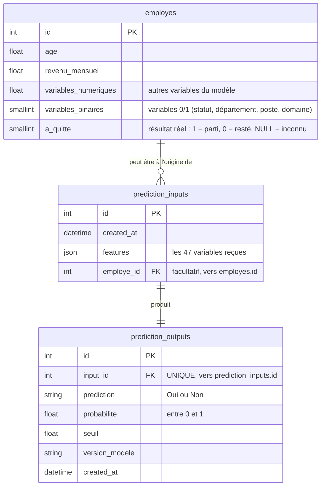

# Modèle de données

Base PostgreSQL (SQLite en développement). Les tables sont définies dans `app/models.py` et créées par `python -m scripts.create_db`.

## Tables

| Table | Rôle | Volume attendu |
|---|---|---|
| `employes` | Dataset d'entraînement : 47 variables du modèle + résultat réel (`a_quitte`) | 1470 lignes, chargées une fois |
| `prediction_inputs` | Une ligne par requête reçue par l'API | Croît à chaque appel |
| `prediction_outputs` | Une ligne par prédiction, liée à son entrée | Même volume que les entrées |

## Contraintes

- **Clés primaires** auto-incrémentées sur les trois tables.
- **Clé étrangère** `prediction_outputs.input_id` vers `prediction_inputs.id` (suppression en cascade) et **unicité** : une entrée a une seule sortie.
- **Clé étrangère** facultative `prediction_inputs.employe_id` vers `employes.id`.
- **Contrôles** (`CHECK`) : `prediction` vaut `Oui` ou `Non` ; `probabilite` entre 0 et 1 ; variables binaires égales à 0 ou 1 ; `age` entre 16 et 100.
- **Colonnes obligatoires** (`NOT NULL`) pour toutes les variables, la prédiction, la probabilité, le seuil et la version du modèle.

## Volume

Les entrées et sorties sont séparées pour que l'historique grossisse sans toucher au dataset. Les clés primaires et l'unicité de `input_id` fournissent les index nécessaires aux jointures. En cas de forte croissance : index sur `created_at` et archivage périodique.
